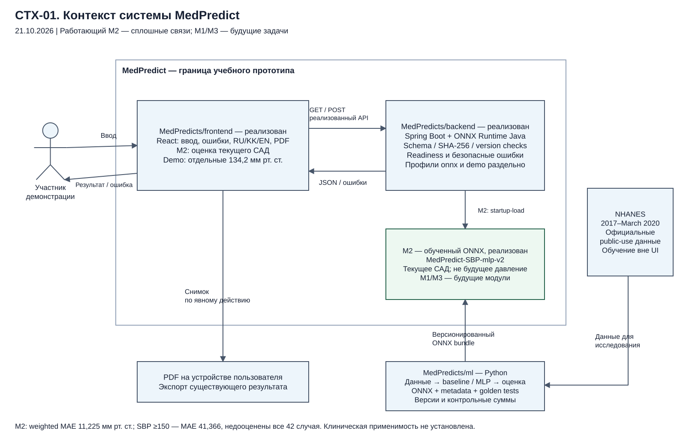

# Диаграммы архитектуры MedPredict

Три схемы для комиссии: контекст системы, варианты использования и компоненты. Исходный срез — 21 октября 2026 года. Схемы отражают исследовательскую локальную M2-интеграцию React → Spring Boot → ONNX и отдельно обозначают будущие возможности.

| ID | Диаграмма | Редактируемый источник | Векторный просмотр | PNG |
|---|---|---|---|---|
| CTX-01 | Контекст системы | [drawio](context.drawio) | [SVG](context.svg) | [PNG](context.png) |
| UC-01 | Варианты использования | [drawio](use-cases.drawio) | [SVG](use-cases.svg) | [PNG](use-cases.png) |
| CMP-01 | Компоненты и обработка | [drawio](components.drawio) | [SVG](components.svg) | [PNG](components.png) |

`.drawio` содержит отдельные узлы, подписи и связи, редактируемые в diagrams.net. После правок исходника обновите SVG/PNG и проверьте читаемость. Сплошные связи обозначают реализованный локальный путь M2; будущие модули и недоступные функции выделены отдельно. Штриховая UML-зависимость include означает обязательную проверку, независимо от статуса реализации.

Схемы не подтверждают наличие ONNX в текущем опубликованном backend: его проверенный исходный срез `3588c363` содержит demo/unavailable-провайдеры. Историческая подпись `MedPredicts/ml` обозначает прежний локальный ML-workspace; актуальный раздел публикации — [ML-AI](https://github.com/MedPredicts/ml-ai#readme). M1 offline benchmark не является выпущенным модулем приложения; M3, аккаунт и история не реализованы в показанном API.

M2 оценивает текущее САД и не заменяет измерение. Weighted MAE — 11,225 мм рт. ст.; при фактическом САД ≥150 все 42 test-случая недооценены, MAE группы — 41,366. Клиническая пригодность и применимость к Казахстану не установлены. Фиксированные 134,2 относятся только к demo.

[README frontend](../../../README.md) · [Документы для комиссии](https://github.com/MedPredicts/documentation#readme) · [Требования](https://github.com/MedPredicts/documentation/blob/main/06_Спецификация_требований.md) · [Архитектура](https://github.com/MedPredicts/documentation/blob/main/07_Архитектура_и_диаграммы.md).
